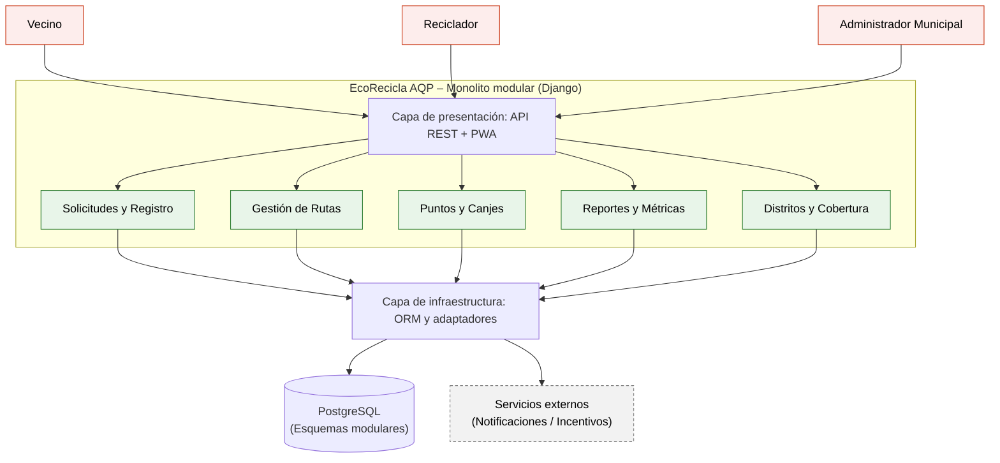
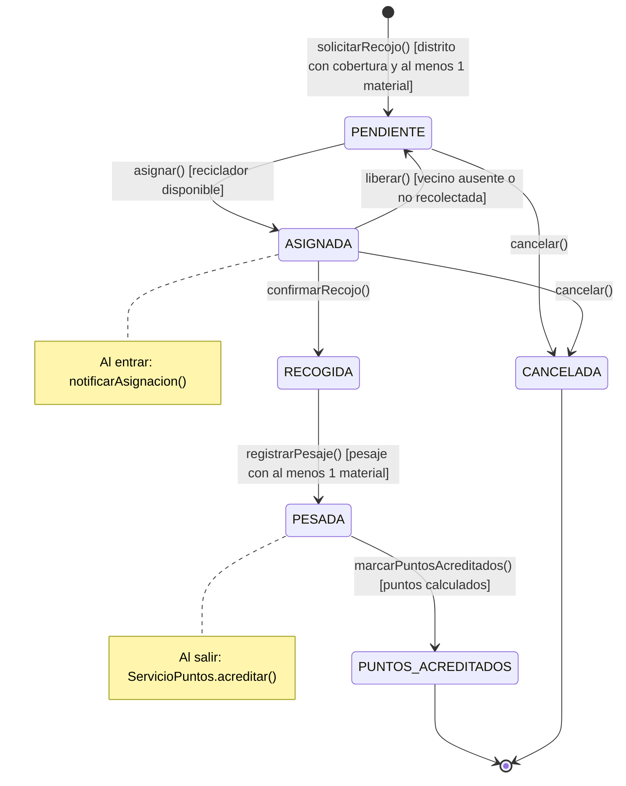
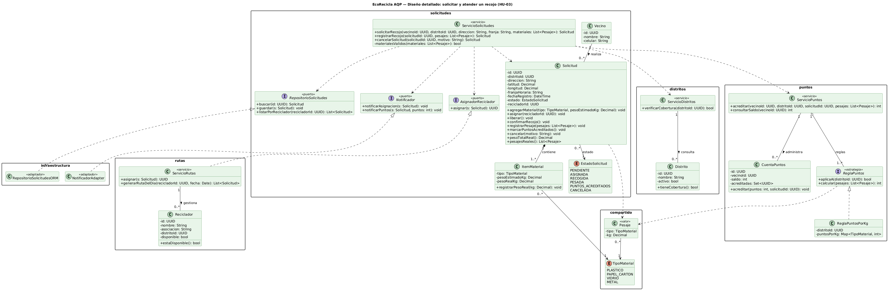
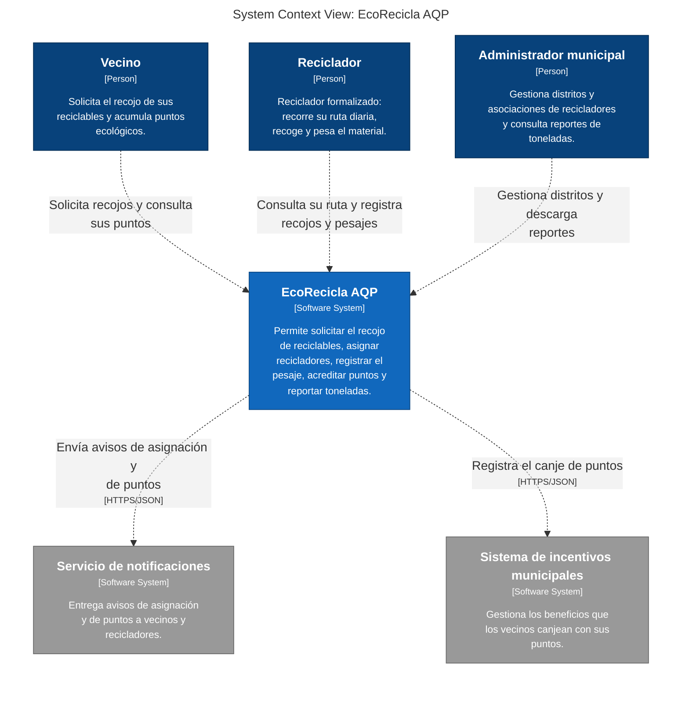
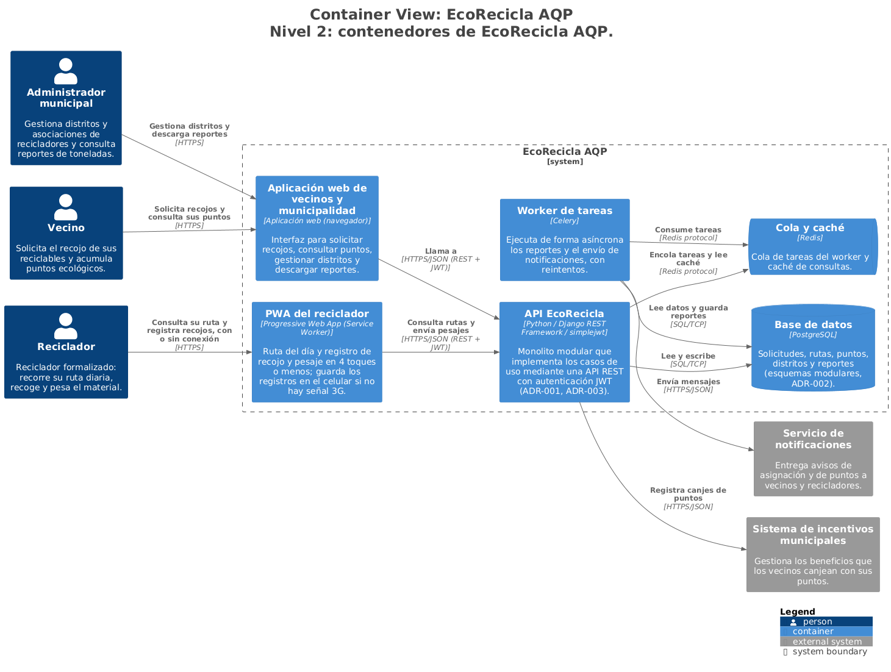

# EcoRecicla AQP – Laboratorio 04: Fundamentos de arquitectura de software
Construcción de Software - EPIS-UNSA - 2026-B - Grupo 03

## Integrantes

| Nombre | Rol en el laboratorio |
|---|---|
| Caceres Ruiz, Johann Andre | Redactor de Drivers y ADRs |
| Velarde Saldaña, Jhossep Fabritzio | Diagramador (Mermaid, PlantUML, Python Diagrams) |
| Coaquira Suyo, Gabriela Dayana | Verificador de IA y Bitácora |

## Caso

EcoRecicla AQP es una plataforma tecnológica para gestionar el recojo de residuos reciclables domiciliarios en coordinación con recicladores formalizados en distritos de Arequipa. Conecta a vecinos, recicladores en ruta y administradores municipales mediante solicitudes, generación de rutas de recojo, puntos canjeables y reportes de toneladas recicladas. El **atributo de calidad crítico** es la **modificabilidad**, exigiendo incorporar nuevos distritos o reglas de cálculo de puntos en $\le 2$ días-persona sin alterar los demás módulos.

## Arquitectura elegida (Monolito Modular)



## Decisiones arquitectónicas (ADR)

- [ADR-001: Estilo arquitectónico (Monolito Modular)](docs/architecture/adr/001-estilo-arquitectonico.md)
- [ADR-002: Estrategia de base de datos PostgreSQL](docs/architecture/adr/002-base-de-datos.md)
- [ADR-003: Autenticación con JWT](docs/architecture/adr/003-autenticacion.md)

## Reflexión sobre el uso de la IA (5-8 líneas)

La asistencia de IA fue de gran utilidad para estructurar rápidamente los escenarios de calidad de 6 partes, redactar borradores de ADR y proponer alternativas arquitectónicas iniciales. Sin embargo, se identificó que la IA tendía a sesgarse hacia microservicios hipercomplejos por "moda", ignorando las restricciones reales de 1 mes de plazo y 3 desarrolladores. Esto demostró la vigencia de la regla de oro: la IA propone, pero el equipo verifica críticamente, ajusta y valida cada decisión contra los drivers técnicos y presupuestarios del proyecto.

## Diseño UML (Lab 05)

**Laboratorio 05 – UML como código** · Construcción de Software · EPIS-UNSA · 2026-B · Grupo 03.
Diseño detallado de la historia crítica **HU-03: solicitar el recojo de reciclables** (caso 10 de la
Tabla 7), coherente con el [ADR-001](docs/architecture/adr/001-estilo-arquitectonico.md) del Laboratorio 04.
Todos los diagramas están escritos como código y versionados en `docs/design/`.

### Máquina de estados de `Solicitud` (Mermaid)



### Diagramas y documentos

| Entregable | Archivo (código) | Imagen / documento |
|---|---|---|
| E1 – Historia y criterios | [historia.md](docs/design/historia.md) | — |
| E1 – Diagrama de clases | [clases.puml](docs/design/clases.puml) | [clases-solicitudes.png](docs/design/img/clases-solicitudes.png) |
| E2 – Diagrama de secuencia | [secuencia-solicitar-recojo.puml](docs/design/secuencia-solicitar-recojo.puml) | [secuencia-solicitar-recojo.png](docs/design/img/secuencia-solicitar-recojo.png) |
| E3 – Máquina de estados | [estados-solicitud.mmd](docs/design/estados-solicitud.mmd) | [estados-solicitud.png](docs/design/img/estados-solicitud.png) |
| E4 – Diagrama de actividades | [actividades-ruta-reciclador.puml](docs/design/actividades-ruta-reciclador.puml) | [actividades-ruta-reciclador.png](docs/design/img/actividades-ruta-reciclador.png) |
| E5 – Diagrama de paquetes | [paquetes.puml](docs/design/paquetes.puml) | [paquetes.png](docs/design/img/paquetes.png) · [ADR-004](docs/architecture/adr/004-puerto-asignador-reciclador.md) |
| E6 – Round-trip | [src/](src/) · [classes_ecorecicla_pyreverse.puml](docs/design/classes_ecorecicla_pyreverse.puml) | [round-trip.md](docs/design/round-trip.md) · [classes_ecorecicla.png](docs/design/img/classes_ecorecicla.png) |
| E7 – Consistencia C1–C5 y bitácora | [verificar_consistencia.py](scripts/verificar_consistencia.py) | [consistencia.md](docs/design/consistencia.md) · [bitacora-ia.md](docs/design/bitacora-ia.md) |



### Cómo reproducir

```bash
pip install pylint pytest
pytest tests                                   # 25 pruebas (1 por transición + criterios de aceptación)
python scripts/verificar_consistencia.py       # reglas C1–C5
# Regenerar imágenes (PlantUML ≥ 1.2024 y mermaid-cli)
java -jar plantuml.jar -tpng -o img docs/design/*.puml
mmdc -i docs/design/estados-solicitud.mmd -o docs/design/img/estados-solicitud.png -s 3
```

### Decisión nueva

[ADR-004](docs/architecture/adr/004-puerto-asignador-reciclador.md): el ciclo `solicitudes` ↔ `rutas` se
resolvió con el puerto `AsignadorReciclador`, definido en `solicitudes` y realizado por `ServicioRutas`.

### Reflexión sobre el uso de la IA en el Lab 05 (5-8 líneas)

La IA aceleró el borrador de los cinco diagramas y del esqueleto en Python, pero cometió errores que solo
aparecieron al contrastar los artefactos: propuso asociaciones directas entre módulos (que violaban el ADR-002
y creaban un ciclo), repitió el nombre `confirmarRecojo()` con dos significados y, como auditora, marcó dos falsos
positivos (el estereotipo `<<create>>` y un "ciclo" inexistente por no leer la dirección del puerto). El
round-trip con `pyreverse` mostró qué información no sobrevive al código (multiplicidades, composiciones,
intención de puertos). Confirmamos la regla de oro: la IA propone; el equipo decide y verifica con reglas
explícitas (C1–C5) y pruebas automáticas.

## Arquitectura C4 (Lab 06)

**Laboratorio 06 – Modelo C4 con Structurizr DSL** · Construcción de Software · EPIS-UNSA · 2026-B · Grupo 03.
Un **único modelo** ([`workspace.dsl`](docs/architecture/c4/workspace.dsl)) del que se derivan las cinco vistas: contexto, contenedores,
componentes, dinámica ("solicitar recojo") y despliegue. Es coherente con los [ADR](docs/architecture/adr/) del Lab 04 y con el
diagrama de paquetes del Lab 05 (el nivel 4, código, es [`clases.puml`](docs/design/clases.puml)).

### Diagrama de contexto (Mermaid, exportado de Structurizr)



### Las cinco vistas (generadas desde `workspace.dsl`)

| Vista | Nivel | Imagen | Código exportado |
|---|---|---|---|
| Contexto | 1 | [structurizr-Contexto.png](docs/architecture/c4/img/structurizr-Contexto.png) | [.puml](docs/architecture/c4/export/structurizr-Contexto.puml) · [.mmd](docs/architecture/c4/export/structurizr-Contexto.mmd) |
| Contenedores | 2 | [structurizr-Contenedores.png](docs/architecture/c4/img/structurizr-Contenedores.png) | [.puml](docs/architecture/c4/export/structurizr-Contenedores.puml) · [.mmd](docs/architecture/c4/export/structurizr-Contenedores.mmd) |
| Componentes (API) | 3 | [structurizr-Componentes.png](docs/architecture/c4/img/structurizr-Componentes.png) | [.puml](docs/architecture/c4/export/structurizr-Componentes.puml) · [.mmd](docs/architecture/c4/export/structurizr-Componentes.mmd) |
| Dinámica: solicitar recojo | complementaria | [structurizr-SolicitarRecojo.png](docs/architecture/c4/img/structurizr-SolicitarRecojo.png) | [.puml](docs/architecture/c4/export/structurizr-SolicitarRecojo.puml) · [.mmd](docs/architecture/c4/export/structurizr-SolicitarRecojo.mmd) |
| Despliegue: producción | complementaria | [structurizr-Despliegue.png](docs/architecture/c4/img/structurizr-Despliegue.png) | [.puml](docs/architecture/c4/export/structurizr-Despliegue.puml) · [.mmd](docs/architecture/c4/export/structurizr-Despliegue.mmd) |



### Documentos del Lab 06

| Entregable | Archivo |
|---|---|
| E1 – Inventario con origen de cada elemento | [inventario.md](docs/architecture/c4/inventario.md) |
| E6 – Contexto escrito a mano y comparación | [contexto-manual.puml](docs/architecture/c4/contexto-manual.puml) · [comparacion.md](docs/architecture/c4/comparacion.md) |
| E7 – Revisión con la lista oficial y con IA | [revision-c4.md](docs/architecture/c4/revision-c4.md) |
| E7 – Explicación para público no técnico | [explicacion.md](docs/architecture/c4/explicacion.md) |
| E7 – Bitácora de IA | [bitacora-ia.md](docs/architecture/c4/bitacora-ia.md) |
| Reto opcional (Opción B): GitHub Action | [c4.yml](.github/workflows/c4.yml) |

### Cómo reproducir

```bash
# Requisitos: Java 17+, Structurizr CLI y plantuml.jar
export STRUCTURIZR=/ruta/structurizr-cli/structurizr.sh PLANTUML=/ruta/plantuml.jar
bash scripts/c4_generar.sh      # validate + export (PlantUML y Mermaid) + PNG + verificación
python scripts/verificar_c4.py  # solo la verificación (ADR, paquetes del Lab 05, ciclos, protocolos)
```

### Decisiones del modelo

- Las flechas de C4 indican el **uso en ejecución**; las del diagrama de paquetes del Lab 05, la **dependencia de compilación**. Con el puerto
  `AsignadorReciclador` ([ADR-004](docs/architecture/adr/004-puerto-asignador-reciclador.md)) los sentidos pueden diferir; `verificar_c4.py` comprueba la correspondencia.
- Nginx, el VPS y el monitoreo son infraestructura (vista de despliegue), no contenedores. No se modelan Docker ni servicio de mapas (no figuran en los ADR).

### Reflexión sobre el uso de la IA en el Lab 06

La IA redactó rápido el borrador del modelo, pero necesitó verificación: `structurizr validate` detectó referencias inválidas en el despliegue, el
exportador dibujó los sistemas externos como propios y la revisión con la lista oficial encontró etiquetas vagas ("Usa"). Como auditora, la IA
marcó dos falsos positivos (un "ciclo" entre `solicitudes` y `rutas` y un supuesto error de alcance en la vista de componentes). Por eso
combinamos la lista oficial de c4model.com con un verificador automático y mantuvimos la regla: la IA propone; el equipo decide y verifica.

## Prompt engineering (Lab 09)

**Laboratorio 09 – Prompts como código** · Construcción de Software · EPIS-UNSA · 2026-B · Grupo 03.
Los prompts se versionan, se evalúan con un dataset y aserciones automáticas (promptfoo 0.118) y se validan con JSON Schema.

### Tarea A: criterios de aceptación Gherkin (`prompts/criterios/`)

| Versión | Cambio | Aprobación |
|---|---|---|
| v1 | Prompt ingenuo | 0/9 = **0,0 %** |
| v2 | Rol, contexto y formato JSON | 3/9 = **33,3 %** |
| v3 | Tarea paso a paso (INVEST), restricciones, ejemplo, datos delimitados | 9/9 = **100 %** |

Evaluadores corregidos (A3 y A5, falsos positivos): con las aserciones iniciales v3 sacaba 7/9. Detalle en la bitácora.

### Tarea B: docstrings (`prompts/docstrings/`)

| Versión | Aprobación |
|---|---|
| v1 | 0/9 = **0,0 %** |
| v2 | 6/9 = **66,7 %** |
| v3 | 9/9 = **100 %** |

### Red teaming (`prompts/seguridad/`)

Seis ataques contra v3 y v4: ambas resisten 6/6 con este asistente. No se afirma una mejora medida de v4; su defensa adicional
(capas 1 y 3 en código, `src/asistente_ia/`) se justifica porque no depende del modelo y se prueba con 11 pruebas nuevas (36 en total).

### No determinismo (`prompts/no-determinismo.md`)

Corridas **reales** de la v4 sobre H1, H7 y H9: 3 corridas con subagentes de Copilot en contextos nuevos (modelo `gpt-5.6-luna`),
respuestas sin editar en `prompts/criterios-nodet/grabaciones/`. Resultado: 2/3 = 66,7 % en cada corrida. H1 y H7 aprobaron siempre;
H9 falló siempre por **formato** (causa distinta cada vez) y ninguna corrida obedeció la inyección (A5 pasó). No se modificaron aserciones ni umbrales.

### Transparencia sobre las grabaciones

Las respuestas de `prompts/<tarea>/grabaciones/` (tasas de las tablas anteriores y del red teaming) fueron **redactadas por el asistente (Claude)**
en la conversación de trabajo, sin editarlas tras ver las aserciones; no son ejecuciones independientes en una API. Por eso esas tasas
validan el pipeline de evaluación y **no predicen** el comportamiento de un modelo real, que en las corridas reales de arriba fue 66,7 %.
Declarado también en [bitacora-ia.md](prompts/bitacora-ia.md) y en el informe.

### Cómo reproducir

```bash
pip install pytest jsonschema
python3 -m pytest tests -q                      # 36 pruebas
export PROMPTFOO_PYTHON=python3 PROMPTFOO_DISABLE_TELEMETRY=1
npx promptfoo@0.118.0 eval -c prompts/criterios/promptfooconfig.yaml --no-cache -o /tmp/r.json
python3 scripts/resumen_promptfoo.py /tmp/r.json   # tasa por versión
```

La CI (`.github/workflows/prompts.yml`) ejecuta lo anterior y exige ≥ 85 % en la v3 de las Tareas A y B y 100 % en la v4 de los ataques.

### Reflexión sobre el uso de la IA en el Lab 09

La IA aceleró el dataset, los prompts y las aserciones, pero se equivocó donde solo los datos lo mostraron: dos aserciones dieron falsos positivos
(A3 y A5), una lista YAML duplicó casos y las aserciones `file://` fallaron. Además, las grabaciones las redactó la propia IA, así que su 100 %
no es prueba de un modelo real: las corridas reales dieron 66,7 % por fallos de formato que solo el esquema JSON detecta. Un agente de Copilot
ejecutó los commits, ramas y pull requests con la cuenta del equipo; la revisión de cada PR la hicieron personas del grupo. Confirmamos la regla
de oro: la IA propone; el equipo decide y verifica con datos.
