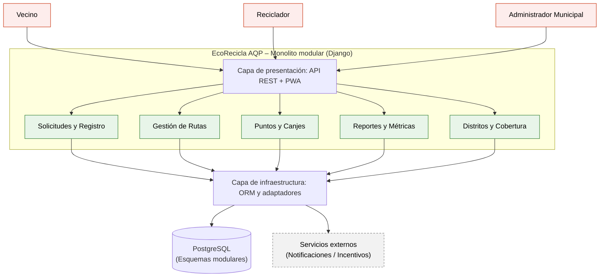
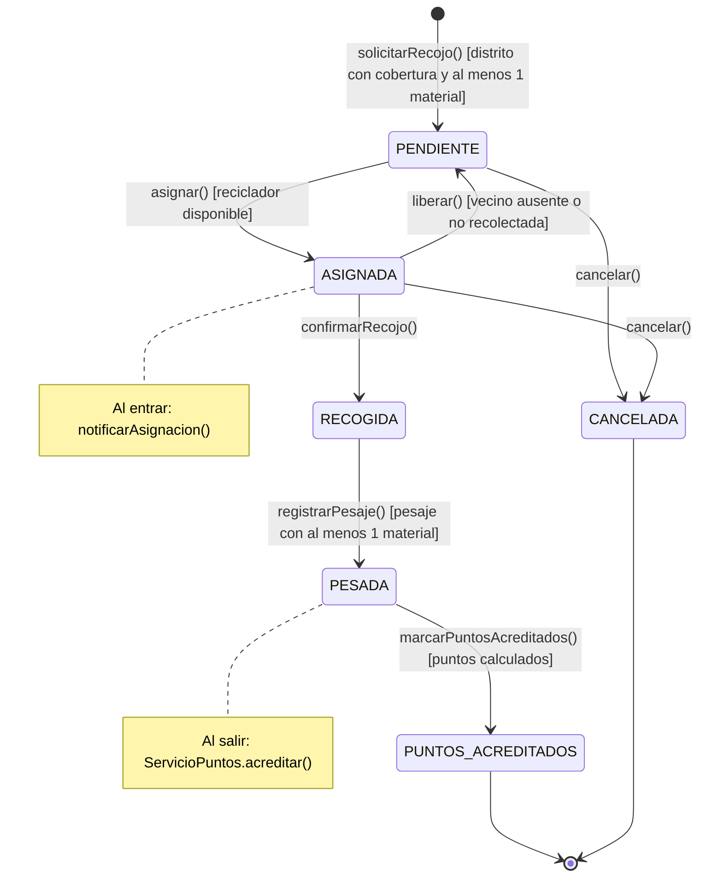
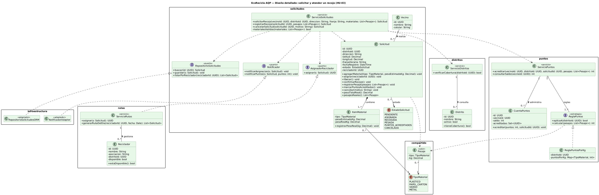

# EcoRecicla AQP – Laboratorio 04: Fundamentos de arquitectura de software
Construcción de Software - EPIS-UNSA - 2026-B - Grupo 03

## Integrantes

| Nombre | Rol en el laboratorio |
|---|---|
| Caceres Ruiz, Johann Andre | Redactor de Drivers y ADRs |
| Velarde Saldaña, Jhossep Fabritzio | Diagramador (Mermaid, PlantUML, Python Diagrams) |
| Coaquira Suyo, Gabriela Dayana | Verificador de IA y Bitácora |

## Caso

EcoRecicla AQP es una plataforma tecnológica para gestionar el recojo de residuos reciclables domiciliarios en coordinación con recicladores formalizados en distritos de Arequipa. Conecta a vecinos, recicladores en ruta y administradores municipales mediante solicitudes, generación de rutas de recojo, puntos canjeables y reportes de toneladas recicladas. El **atributo de calidad crítico** es la **modificabilidad**, exigiendo incorporar nuevos distritos o reglas de cálculo de puntos en $\le 2$ días-persona sin alterar los demás módulos.

## Arquitectura elegida (Monolito Modular)



## Decisiones arquitectónicas (ADR)

- [ADR-001: Estilo arquitectónico (Monolito Modular)](docs/architecture/adr/001-estilo-arquitectonico.md)
- [ADR-002: Estrategia de base de datos PostgreSQL](docs/architecture/adr/002-base-de-datos.md)
- [ADR-003: Autenticación con JWT](docs/architecture/adr/003-autenticacion.md)

## Reflexión sobre el uso de la IA (5-8 líneas)

La asistencia de IA fue de gran utilidad para estructurar rápidamente los escenarios de calidad de 6 partes, redactar borradores de ADR y proponer alternativas arquitectónicas iniciales. Sin embargo, se identificó que la IA tendía a sesgarse hacia microservicios hipercomplejos por "moda", ignorando las restricciones reales de 1 mes de plazo y 3 desarrolladores. Esto demostró la vigencia de la regla de oro: la IA propone, pero el equipo verifica críticamente, ajusta y valida cada decisión contra los drivers técnicos y presupuestarios del proyecto.

## Diseño UML (Lab 05)

**Laboratorio 05 – UML como código** · Construcción de Software · EPIS-UNSA · 2026-B · Grupo 03.
Diseño detallado de la historia crítica **HU-03: solicitar el recojo de reciclables** (caso 10 de la
Tabla 7), coherente con el [ADR-001](docs/architecture/adr/001-estilo-arquitectonico.md) del Laboratorio 04.
Todos los diagramas están escritos como código y versionados en `docs/design/`.

### Máquina de estados de `Solicitud` (Mermaid)



### Diagramas y documentos

| Entregable | Archivo (código) | Imagen / documento |
|---|---|---|
| E1 – Historia y criterios | [historia.md](docs/design/historia.md) | — |
| E1 – Diagrama de clases | [clases.puml](docs/design/clases.puml) | [clases-solicitudes.png](docs/design/img/clases-solicitudes.png) |
| E2 – Diagrama de secuencia | [secuencia-solicitar-recojo.puml](docs/design/secuencia-solicitar-recojo.puml) | [secuencia-solicitar-recojo.png](docs/design/img/secuencia-solicitar-recojo.png) |
| E3 – Máquina de estados | [estados-solicitud.mmd](docs/design/estados-solicitud.mmd) | [estados-solicitud.png](docs/design/img/estados-solicitud.png) |
| E4 – Diagrama de actividades | [actividades-ruta-reciclador.puml](docs/design/actividades-ruta-reciclador.puml) | [actividades-ruta-reciclador.png](docs/design/img/actividades-ruta-reciclador.png) |
| E5 – Diagrama de paquetes | [paquetes.puml](docs/design/paquetes.puml) | [paquetes.png](docs/design/img/paquetes.png) · [ADR-004](docs/architecture/adr/004-puerto-asignador-reciclador.md) |
| E6 – Round-trip | [src/](src/) · [classes_ecorecicla_pyreverse.puml](docs/design/classes_ecorecicla_pyreverse.puml) | [round-trip.md](docs/design/round-trip.md) · [classes_ecorecicla.png](docs/design/img/classes_ecorecicla.png) |
| E7 – Consistencia C1–C5 y bitácora | [verificar_consistencia.py](scripts/verificar_consistencia.py) | [consistencia.md](docs/design/consistencia.md) · [bitacora-ia.md](docs/design/bitacora-ia.md) |



### Cómo reproducir

```bash
pip install pylint pytest
pytest tests                                   # 25 pruebas (1 por transición + criterios de aceptación)
python scripts/verificar_consistencia.py       # reglas C1–C5
# Regenerar imágenes (PlantUML ≥ 1.2024 y mermaid-cli)
java -jar plantuml.jar -tpng -o img docs/design/*.puml
mmdc -i docs/design/estados-solicitud.mmd -o docs/design/img/estados-solicitud.png -s 3
```

### Decisión nueva

[ADR-004](docs/architecture/adr/004-puerto-asignador-reciclador.md): el ciclo `solicitudes` ↔ `rutas` se
resolvió con el puerto `AsignadorReciclador`, definido en `solicitudes` y realizado por `ServicioRutas`.

### Reflexión sobre el uso de la IA en el Lab 05 (5-8 líneas)

La IA aceleró el borrador de los cinco diagramas y del esqueleto en Python, pero cometió errores que solo
aparecieron al contrastar los artefactos: propuso asociaciones directas entre módulos (que violaban el ADR-002
y creaban un ciclo), repitió el nombre `confirmarRecojo()` con dos significados y, como auditora, marcó dos falsos
positivos (el estereotipo `<<create>>` y un "ciclo" inexistente por no leer la dirección del puerto). El
round-trip con `pyreverse` mostró qué información no sobrevive al código (multiplicidades, composiciones,
intención de puertos). Confirmamos la regla de oro: la IA propone; el equipo decide y verifica con reglas
explícitas (C1–C5) y pruebas automáticas.
